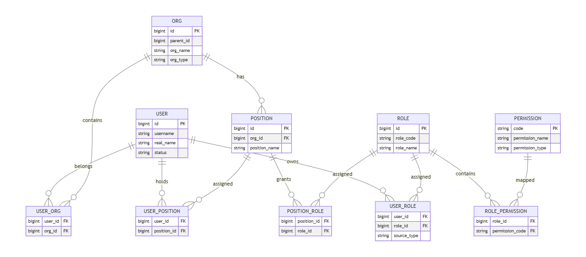

# h-boot

[English](README.en.md) | 简体中文

`h-boot` 是一个持续维护的前后端分离管理平台后端，面向权限管理、工作流、知识管理和可复用业务模块开发。项目基于 Spring Boot 3.5、MyBatis-Plus、Sa-Token、Warm-Flow 和 Spring AI，支持 PostgreSQL 17 与 MySQL 8。

配套前端：[h-boot-admin](https://gitee.com/438704315/h-boot-admin)

> 项目目前处于积极开发阶段，适合学习、二次开发和功能验证。用于生产环境前，请完成测试、安全、监控、备份及发布流程评估，详见[上线可用框架缺口清单](docs/production-readiness-checklist.md)。

## 项目目标

- 提供用户、角色、菜单、部门、岗位和字典等通用管理能力。
- 提供可视化流程设计、任务办理和流程实例管理能力。
- 探索 AI 对话、文档总结和知识库问答在管理系统中的实际应用。
- 保持后端 API 与 Vue 管理端解耦，便于按业务模块扩展。

## 已实现功能

| 模块 | 能力 |
| --- | --- |
| 认证与权限 | Sa-Token 登录认证，用户、角色、菜单、部门、岗位与动态权限 |
| 工作流 | 流程分类、流程定义、可视化设计、实例、待办、已办、抄送及请假示例 |
| 知识库 | Markdown 文章、版本历史、批注、文件导入、AI 总结与文章问答 |
| AI 助手 | 通过 Spring AI 接入 OpenAI 兼容接口，提供基础对话能力 |
| 文件中心 | 文件上传、批量查询、预览、下载及扩展名/MIME 类型校验 |
| 内容管理 | CMS 内容维护和富文本编辑数据接口 |
| 家庭相册 | 相册、照片和视频管理，标签、移动/复制、离线导出 |
| 代码生成 | 数据表读取、生成配置、代码预览和下载 |
| 系统审计 | 登录日志、操作日志、Trace 上下文、慢 SQL 与索引审计 |
| 运维基础 | Actuator 健康检查、OpenAPI、Druid 和多环境配置开关 |

## 技术栈

| 分类 | 技术 |
| --- | --- |
| 核心框架 | Java 17、Spring Boot 3.5.9 |
| 数据访问 | MyBatis-Plus 3.5.16、Druid、动态数据源 |
| 数据存储 | PostgreSQL 17 / MySQL 8、Redis |
| 认证授权 | Sa-Token |
| 工作流 | Warm-Flow 1.8.5 |
| AI | Spring AI 1.1.2、OpenAI 兼容接口 |
| 接口文档 | Springdoc OpenAPI |
| 工具 | MapStruct Plus、Lombok、Hutool |

前端采用 Vue 3、TypeScript、Vite、Element Plus、Pinia 和 Vue Router，具体版本见 [h-boot-admin](https://gitee.com/438704315/h-boot-admin)。

## 项目结构

```text
h-boot/
├── src/main/java/com/quinn/hboot/
│   ├── ai/          # AI 对话
│   ├── codegen/     # 代码生成
│   ├── common/      # 通用模型、异常、日志和 Trace
│   ├── knowledge/   # 知识库
│   ├── photo/       # 相册与媒体管理
│   ├── system/      # 认证、权限及系统管理
│   └── workflow/    # 工作流
├── src/main/resources/
│   ├── mapper/      # MyBatis Mapper XML
│   └── templates/   # 代码生成模板
├── docs/            # 设计、启动和上线文档
└── sql/             # MySQL 与 PostgreSQL 初始化/迁移脚本
```

## 快速开始

### 1. 环境要求

- JDK 17
- PostgreSQL 17 或 MySQL 8
- Redis 6+
- Maven Wrapper（仓库已包含，无需单独安装 Maven）
- Node.js 20.19+ 或 22.12+（运行配套前端时需要）

### 2. 获取代码

```bash
git clone https://gitee.com/438704315/h-boot.git
git clone https://gitee.com/438704315/h-boot-admin.git
```

### 3. 初始化 PostgreSQL

开发环境默认使用 PostgreSQL：

```bash
createdb h_boot
psql -X -d h_boot -f sql/postgresql/import.sql
```

MySQL 用户可导入 `sql/h_boot.sql`，并通过环境变量切换 JDBC 地址和账号。

### 4. 配置环境变量

配置项模板见 [.env.example](.env.example)。至少根据本机环境设置数据库与 Redis：

```bash
export SPRING_PROFILES_ACTIVE=dev
export HBOOT_DB_URL='jdbc:postgresql://localhost:5432/h_boot'
export HBOOT_DB_USERNAME='your-user'
export HBOOT_DB_PASSWORD='your-password'
export ENGINE_DB_URL="$HBOOT_DB_URL"
export ENGINE_DB_USERNAME="$HBOOT_DB_USERNAME"
export ENGINE_DB_PASSWORD="$HBOOT_DB_PASSWORD"
export REDIS_HOST='localhost'
export REDIS_PORT='6379'
```

AI 功能不是启动系统的前置条件。需要使用时，再配置 `AI_BASE_URL`、`AI_API_KEY` 和 `AI_MODEL`。

### MacBook 本地依赖启动

以下命令适用于通过 Homebrew 安装的 PostgreSQL 17 和 Redis。命令均为手动启动，不会设置开机自动启动；`brew --prefix` 会自动适配 Apple Silicon 和 Intel Mac 的安装路径。

安装依赖（首次使用）：

```bash
brew install postgresql@17 redis
```

#### PostgreSQL

```bash
# 启动
PG_BIN="$(brew --prefix postgresql@17)/bin"
PG_DATA="$(brew --prefix)/var/postgresql@17"
PG_LOG="$(brew --prefix)/var/log/postgresql@17.log"
"$PG_BIN/pg_ctl" -D "$PG_DATA" -l "$PG_LOG" start

# 检查状态
"$PG_BIN/pg_ctl" -D "$PG_DATA" status
"$PG_BIN/pg_isready" -h localhost -p 5432

# 连接项目数据库
"$PG_BIN/psql" -h localhost -U pingguo -d h_boot

# 停止
"$PG_BIN/pg_ctl" -D "$PG_DATA" stop
```

#### Redis

```bash
REDIS_BIN="$(brew --prefix redis)/bin"
REDIS_CONF="$(brew --prefix)/etc/redis.conf"

# 后台启动
"$REDIS_BIN/redis-server" "$REDIS_CONF" --daemonize yes

# 检查状态，返回 PONG 表示已启动
"$REDIS_BIN/redis-cli" ping

# 停止后台 Redis
"$REDIS_BIN/redis-cli" shutdown
```

### 5. 启动后端

```bash
./mvnw spring-boot:run
```

默认地址：

- 后端 API：`http://localhost:8080`
- 健康检查：`http://localhost:8080/actuator/health`
- Swagger UI（`dev` 环境）：`http://localhost:8080/swagger-ui/index.html`

### 6. 启动前端

```bash
cd ../h-boot-admin
npm install
npm run dev
```

前端默认运行在 `http://localhost:5173`，开发服务器会把 `/api`、`/warm-flow` 和 `/warm-flow-ui` 代理到后端 `8080` 端口。

更完整的环境变量和生产启动说明见[环境变量与启动说明](docs/environment-and-startup.md)。

## 架构概览

```text
Browser
   |
   v
h-boot-admin (Vue 3 + TypeScript)
   |
   | HTTP / JSON
   v
h-boot (Spring Boot)
   |-- PostgreSQL / MySQL    业务与流程数据
   |-- Redis                 会话、权限与缓存
   |-- Local file storage    文件和媒体资源
   `-- OpenAI-compatible API 可选的 AI 能力
```

RBAC 数据模型：



## 文档

- [环境变量与启动说明](docs/environment-and-startup.md)
- [生产就绪检查清单](docs/production-readiness-checklist.md)
- [AI 集成方案](docs/ai-integration-plan.md)
- [家庭相册实现方案](docs/family-album-implementation-plan.md)
- [PostgreSQL 初始化脚本说明](sql/postgresql/README.md)

## 维护记录与路线图

项目自 2025 年 12 月开始公开维护，主要里程碑包括：

- `2025-12`：系统管理、文件中心、CMS 与日志模块。
- `2026-01` 至 `2026-05`：工作流设计、流程办理和代码生成持续完善。
- `2026-06`：认证迁移至 Sa-Token，并补充 AI 与安全治理能力。
- `2026-08`：增加知识库和家庭相册模块。

后续重点：

- 增加核心认证、权限和工作流链路的自动化测试。
- 完善数据库迁移、监控告警、备份与回滚流程。
- 推进数据权限、对象存储适配和知识库检索能力。
- 逐步清理历史兼容代码，完善模块化扩展机制。

路线图表示维护方向，不构成发布时间承诺。

## 参与贡献

欢迎通过 Issue 和 Pull Request 参与项目：

1. Fork 仓库并从 `master` 创建功能分支。
2. 保持改动聚焦，并为关键逻辑补充测试或验证说明。
3. 提交前运行 `./mvnw test`。
4. 在 Pull Request 中说明问题、实现方式和验证结果。

提交安全问题时，请不要在公开 Issue 中附带真实密钥、生产地址或敏感数据。

## 开源致谢

本项目使用并参考了 Spring Boot、MyBatis-Plus、Sa-Token、Warm-Flow、Spring AI、Vue、Element Plus 等开源项目。部分管理系统设计思路参考了 [RuoYi-Vue-Plus](https://gitee.com/dromara/RuoYi-Vue-Plus)。请在使用及分发时同时遵守本项目与各上游依赖的许可证条款。

## 许可证

本项目基于 [Apache License 2.0](LICENSE) 开源。
