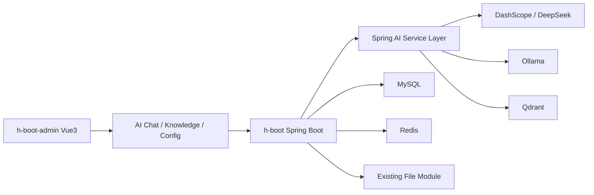

# h-boot AI 集成方案

## 目标定位

这份方案面向当前工作区里的 `h-boot + h-boot-admin`：

- 后端：`Spring Boot 3.5`、`MyBatis-Plus`、`Redis`、`MySQL`
- 前端：`Vue 3`、`Vite`、`Element Plus`
- 现状：已经具备用户、权限、文件、CMS、工作流等基础模块

目标不是“为了接 AI 而接 AI”，而是把 AI 做成这套管理系统里的一个可控能力层，先解决聊天、流式输出、知识库检索、业务辅助，再逐步进入流程协同和 Agent 化。

---

## 结论先行

这套项目如果要加 AI，我建议集成下面这组组合：

| 层次 | 推荐选型 | 结论 |
| --- | --- | --- |
| AI 应用框架 | `Spring AI` | 作为统一接入层，屏蔽不同模型厂商差异 |
| 云模型接入 | `OpenAI 兼容协议` | 生产优先走 `阿里云百炼`，可切 `DeepSeek` |
| 本地开发模型 | `Ollama` | 本地联调、离线开发、低成本验证 |
| 流式输出 | `SSE` | 适合当前管理后台“问答/生成/审批建议”场景 |
| 向量检索 | `Qdrant` | 作为正式知识库向量库首选 |
| 会话与缓存 | 复用 `Redis` | 保存会话态、限流、热点结果缓存 |
| 文件入口 | 复用现有文件模块 | 文档上传、切片、入库、重建索引 |
| 前端交互 | 在 `h-boot-admin` 增加 AI 工作台 | 聊天、知识库、模型配置、调用审计 |

一句话结论：

> 推荐路线是 `Spring AI + OpenAI兼容云模型 + Ollama + SSE + Qdrant + Redis`。

---

## 为什么是这套组合

### 1. 为什么选 Spring AI

当前后端本身就是标准 Spring Boot 项目，`Spring AI` 比单独接 SDK 或再引入一层 Python 服务更贴合现有工程形态。

结合官方文档，它比较适合这套项目的原因有：

- 提供跨模型厂商的统一 Chat、Embedding、Vector Store 抽象
- 同时支持同步和流式调用
- 支持结构化输出、工具调用、RAG、MCP、评测与可观测性
- 可以较低成本在 `Ollama / OpenAI / DeepSeek / 其他兼容接口` 之间切换

这意味着你后面不容易被单一模型厂商绑定死。

### 2. 为什么模型层优先走 OpenAI 兼容协议

对这类后台项目来说，最重要的不是“某个模型名字”，而是“接入方式稳定、替换成本低”。

目前几条比较顺的接法是：

- 生产默认：`阿里云百炼`
- 成本/推理补充：`DeepSeek`
- 本地开发：`Ollama`

它们都能走 OpenAI 兼容接口或等价兼容接法，这样后端只要把模型配置做成可切换，就能在不同环境使用不同模型。

### 3. 为什么向量库推荐 Qdrant

当前项目主数据库是 `MySQL`，缓存是 `Redis`。如果直接为了 RAG 改成 `PostgreSQL + pgvector`，会额外引入一套新的主数据库形态；如果把向量检索强塞进现有 Redis，又会让缓存和知识检索职责混在一起。

所以更稳的做法是：

- 业务主数据继续放 `MySQL`
- 会话、缓存、限流继续放 `Redis`
- 语义检索单独交给 `Qdrant`

这样职责清晰，也更方便后续做知识库独立扩容、过滤检索和重建索引。

### 4. 为什么流式输出用 SSE

你这个项目是后台管理系统，不是 IM 产品，核心需求是：

- 边生成边展示
- 页面实现简单
- 审计和权限边界清楚

所以比起一开始就上 WebSocket，先用 `SSE` 更合适。它足够支撑：

- AI 对话
- 文案生成
- 审批意见生成
- 知识库问答

---

## 推荐架构



### 架构分工

- `MySQL`：业务主数据、AI 会话元数据、知识库文档记录、审计记录
- `Redis`：会话上下文缓存、限流、短期结果缓存、SSE 任务状态
- `Qdrant`：文档切片向量、检索过滤、相似度召回
- `Spring AI`：模型调用、Prompt 编排、RAG 检索、工具调用、结构化输出
- `Ollama`：本地开发和离线验证

---

## 分阶段实施

## P0：先把 AI 主链路跑通

目标：先让系统具备“可用的 AI 对话能力”，不要一上来做大而全平台。

### 范围

- 增加 `AI 对话` 后端接口
- 支持同步问答和 `SSE` 流式问答
- 模型配置支持：
  - `dashscope`
  - `deepseek`
  - `ollama`
- 增加基础会话管理：
  - 新建会话
  - 查询历史
  - 删除会话
- 增加最小审计：
  - 调用人
  - 模型
  - token 用量
  - 耗时
  - 成功失败

### 这阶段先不做

- 不做复杂多 Agent
- 不做自动执行高风险业务动作
- 不让模型直接写数据库
- 不做“全站 AI 接管”

### P0 交付物

- 管理后台出现一个可用的 AI 助手页
- 支持模型切换
- 支持流式输出
- 支持基础历史会话
- 支持最小可追溯审计

---

## P1：补知识库 RAG，让 AI 真正知道系统内容

目标：从“通用聊天”进入“带业务知识的问答”。

### 范围

- 新增知识库管理
- 对接现有文件上传能力
- 文档处理链路：
  - 上传文档
  - 文本抽取
  - 切片
  - embedding
  - 写入 Qdrant
- 问答时引入检索增强：
  - 先检索
  - 再拼 Prompt
  - 最后回答
- 支持元数据过滤：
  - 系统模块
  - 租户/组织
  - 文档类型
  - 状态

### 优先接入的知识源

- 系统帮助文档
- CMS 内容
- 流程制度文档
- 常见问题库
- 文件中心中明确标记为“可入知识库”的资料

### P1 交付物

- AI 不再只是泛化回答
- 能回答“这个系统里的规则、流程、内容、操作说明”
- 回答结果带引用来源或命中文档提示

---

## P2：进入业务助手，而不是只有聊天框

目标：把 AI 嵌入现有模块，提高业务效率。

### 建议的业务切入点

- `CMS`：摘要、改写、标题建议、SEO 描述生成
- `工作流`：审批意见草稿、流程说明生成、待办摘要
- `文件中心`：文档摘要、标签建议、智能分类
- `SQL 审核`：风险解释、人话说明、优化建议
- `系统管理`：菜单说明生成、字典项描述生成、操作帮助

### 这阶段可以考虑的能力

- 结构化输出到 DTO
- 工具调用
- MCP 接入
- 简单 Agent 编排

但建议保持原则：

- AI 给“建议”和“草稿”
- 最终动作由人确认或由显式授权接口执行

---

## 当前项目里的落点建议

## 后端包结构

建议新增包：

```text
com.quinn.hboot.ai
├─ config
├─ controller
├─ service
├─ service.impl
├─ model
│  ├─ dto
│  ├─ query
│  ├─ vo
│  └─ entity
├─ prompt
├─ rag
├─ tool
├─ mapper
└─ convert
```

### 模块职责

- `config`：Spring AI、模型路由、SSE、限流配置
- `controller`：聊天、知识库、模型配置、审计接口
- `service`：会话编排、Prompt 拼装、RAG 检索
- `prompt`：系统 Prompt 模板、场景模板
- `rag`：文档切片、embedding、向量检索、重建索引
- `tool`：给模型可调用的内部工具，但只开放低风险能力

---

## 数据库设计建议

建议先新增以下表：

### 1. `ai_chat_session`

用途：保存会话头信息

建议字段：

- `id`
- `title`
- `user_id`
- `provider`
- `model_name`
- `biz_type`
- `status`
- `created_at`
- `updated_at`

### 2. `ai_chat_message`

用途：保存会话消息明细

建议字段：

- `id`
- `session_id`
- `role`
- `content`
- `tokens_in`
- `tokens_out`
- `latency_ms`
- `trace_id`
- `created_at`

### 3. `ai_knowledge_document`

用途：知识库文档主表

建议字段：

- `id`
- `name`
- `file_id`
- `doc_type`
- `source_type`
- `status`
- `tenant_id`
- `biz_tag`
- `created_at`

### 4. `ai_knowledge_chunk`

用途：切片记录表

建议字段：

- `id`
- `document_id`
- `chunk_no`
- `content`
- `token_count`
- `metadata_json`
- `vector_id`
- `created_at`

### 5. `ai_call_log`

用途：调用审计

建议字段：

- `id`
- `user_id`
- `provider`
- `model_name`
- `scene_code`
- `success_flag`
- `latency_ms`
- `tokens_in`
- `tokens_out`
- `error_message`
- `created_at`

---

## 接口设计建议

P0 先做下面几组接口就够：

### 对话接口

- `POST /api/ai/chat`
- `GET /api/ai/chat/stream`
- `GET /api/ai/session/list`
- `GET /api/ai/session/{id}/messages`
- `DELETE /api/ai/session/{id}`

### 知识库接口

- `POST /api/ai/knowledge/document/upload`
- `POST /api/ai/knowledge/document/{id}/reindex`
- `GET /api/ai/knowledge/document/page`
- `DELETE /api/ai/knowledge/document/{id}`

### 配置与审计接口

- `GET /api/ai/provider/list`
- `POST /api/ai/provider/test`
- `GET /api/ai/log/page`

---

## 前端改造建议

建议在 `h-boot-admin` 里增加 4 个页面：

- `AI 助手`
- `知识库管理`
- `模型配置`
- `调用日志`

### AI 助手页最小能力

- 左侧会话列表
- 中间聊天区
- 底部输入框
- 支持停止生成
- 支持流式输出
- 支持重新回答
- 支持切换模型
- 支持显示命中的知识来源

### 知识库页最小能力

- 上传文档
- 重建索引
- 查看状态
- 查看切片数量
- 查看失败原因

---

## 安全与治理要求

AI 一旦接进后台，安全和审计必须比 Demo 更先落地。

### 必做项

- 所有 AI 接口走后端鉴权
- 对不同角色控制 AI 能力范围
- 对 Prompt、上下文、知识库来源做服务端拼装
- 不允许前端直接传“系统 Prompt”
- 对敏感字段做脱敏
- 对单用户做限流和日额度限制
- 记录 token 消耗与失败日志

### 高风险项先禁掉

- 模型直连数据库执行写操作
- 模型直接调用高风险系统接口
- 未审计的外部网页抓取
- 用户上传任意文件后自动入知识库且直接可检索

---

## 我建议的首批业务场景

如果只能先做 3 个，我建议按这个顺序：

### 1. AI 助手

价值最大，且最容易验证链路是否打通。

### 2. CMS 智能写作

最适合出效果，用户能直观看到收益。

### 3. 工作流审批辅助

能和你现在已有的工作流模块形成联动，体现系统化价值。

---

## 不建议现在就做的事

- 不建议一开始就做多智能体平台
- 不建议一开始就接入十几种模型
- 不建议先做“AI 自动审批”
- 不建议把向量检索塞进现有普通 Redis 用法里硬凑
- 不建议为了 AI 改造现有主业务数据库结构

---

## 依赖建议

后端依赖建议按能力拆分，不要一次性把所有 Provider 都塞进去。

### P0 建议引入

- `spring-ai` BOM
- `spring-ai` OpenAI 模型接入
- `spring-ai` Ollama 模型接入

说明：

- 云模型层优先通过 OpenAI 兼容方式接 `百炼 / DeepSeek`
- 本地模型走 `Ollama`

### P1 再引入

- `spring-ai` Qdrant Vector Store
- 文档解析相关依赖
- 需要时补充重排模型或 rerank 能力

---

## 推荐实施顺序

### 第 1 周

- 接入 Spring AI
- 打通 DashScope/DeepSeek/Ollama 三种配置
- 完成同步问答和 SSE 流式输出

### 第 2 周

- 补会话管理
- 补调用日志
- 前端完成 AI 助手页

### 第 3 到 4 周

- 上 Qdrant
- 完成文档切片、embedding、索引入库
- 完成知识库问答

### 第 5 到 6 周

- 接入 CMS 智能生成
- 接入工作流审批辅助
- 开始做权限、限流、成本治理

---

## 最终建议

如果你希望这套项目的 AI 能力既能快速落地，又不把架构搞乱，我建议直接按下面这条线推进：

1. 用 `Spring AI` 作为统一 AI 接入层
2. 生产模型统一走 `OpenAI 兼容协议`
3. 生产默认优先接 `阿里云百炼`，按场景补 `DeepSeek`
4. 本地开发统一走 `Ollama`
5. 流式输出先用 `SSE`
6. RAG 正式选型优先 `Qdrant`
7. `Redis` 继续做会话缓存、限流和热点结果缓存
8. 先做“聊天 + 知识库 + CMS/流程辅助”，不要一开始就做复杂 Agent 平台

这条路线和当前 `h-boot` 的技术栈是顺的，扩展空间也够大。

---

## 参考链接

以下选型依据里，带“官方”的是我查到的当前官方资料；“推断”部分是结合当前项目结构给出的工程判断。

- Spring AI 官方文档：<https://docs.spring.io/spring-ai/reference/index.html>
- Spring AI Chat Model API：<https://docs.spring.io/spring-ai/reference/api/chatmodel.html>
- Spring AI Vector Store：<https://docs.spring.io/spring-ai/reference/api/vectordbs.html>
- Spring AI Qdrant：<https://docs.spring.io/spring-ai/reference/api/vectordbs/qdrant.html>
- Ollama OpenAI 兼容说明：<https://ollama.com/blog/openai-compatibility>
- DeepSeek API 文档：<https://api-docs.deepseek.com/>
- 阿里云百炼 OpenAI 兼容说明：<https://help.aliyun.com/zh/model-studio/compatibility-of-openai-with-dashscope>
- Qdrant 官方文档：<https://qdrant.tech/documentation/>
- pgvector 官方仓库：<https://github.com/pgvector/pgvector>

