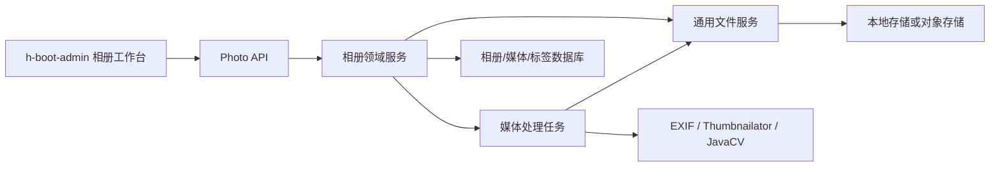
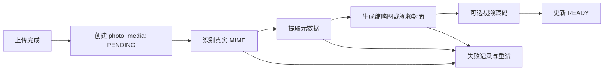

# h-boot 家庭相册功能建设方案

## 1. 文档目标

本文面向当前 `h-boot + h-boot-admin` 项目，给出家庭相册功能的领域划分、数据模型、接口、前端页面、媒体处理、权限安全和分阶段实施方案。

首要目标是复用已有文件上传能力，同时避免把相册业务直接堆进通用文件管理模块。

## 当前实施状态（2026-08-14）

首个可用闭环已经落地：

- 已执行 `sql/photo_album_v1.sql`，创建 9 张 `photo_*` 表并扩展 `sys_file` 文件归属字段。
- 已实现个人空间自动创建、相册增删改查、图片/视频上传、目录相对路径保存、媒体分页和详情。
- 已实现图片像素、EXIF 拍摄时间、GPS、相机/镜头信息，以及视频尺寸、时长、编码和帧率提取。
- 已实现标签设置、条件搜索、软删除，以及媒体在相册间复制或移动。
- 已实现受登录保护的预览/下载，文件去重范围已收紧为“用户 + 业务类型 + 哈希”。
- 已实现离线相册 ZIP 导出，包含原始媒体、`index.html`、`album.json` 和 `checksums.sha256`。
- 前端已实现多文件/目录上传、上传进度、三种展示模式、大图详情、视频播放和元数据编辑。

下一阶段优先项：实际缩略图和视频海报异步生成、HTTP Range 或短期签名播放地址、失败重试、回收站、时间轴和批量分片上传。当前视频预览会先获取完整 Blob，不适合超大视频。

## 2. 需求范围

### 2.1 核心能力

- 上传图片和视频。
- 支持多选批量上传、拖拽上传和选择目录上传。
- 记录文件名称、大小、类型、拍摄时间、上传时间、地点、像素、方向、设备、视频时长等信息。
- 创建、编辑、删除相册并设置封面。
- 将多张图片或视频复制到相册，或从一个相册移动到另一个相册。
- 单个或批量维护标签。
- 按名称、类型、时间、地点、相册、标签、收藏状态等条件搜索。
- 支持明细列表、小图网格、中图网格三种展示模式。
- 图片支持大图查看和非破坏编辑，视频支持在线播放。
- 支持收藏、回收站、时间轴等家庭相册常用能力。
- 将整理好的一个或多个相册导出到磁盘，供直接浏览、复制到其他电脑或导入第三方照片软件。

### 2.2 建议后续能力

- 家庭空间及家庭成员协作。
- 分享链接、访问密码和有效期。
- 地图视图、人物聚类、相似照片和重复照片检测。
- HEIC、Live Photo、RAW 等格式支持。
- 智能标签、图片描述、OCR 和自然语言搜索。
- 手机端自动备份。

### 2.3 首期不建议做

- 视频剪辑器。
- 覆盖原文件的破坏性图片编辑。
- 未经人工确认的人脸身份识别。
- 将浏览器选择的本地绝对路径保存到数据库。
- 上传时在 HTTP 请求线程内同步完成全部缩略图和视频转码。

## 3. 当前项目现状

## 3.1 可以复用的能力

| 现有能力 | 代码位置 | 复用方式 |
| --- | --- | --- |
| 单文件上传 | `system/controller/FileController` | 复用上传入口或下沉为内部文件服务 |
| 批量上传队列 | `FileUploadBatch.vue` | 复用队列、并发数、状态和失败重试思路 |
| 大文件分片 | `/api/v1/file/upload/chunk`、`merge` | 视频上传继续使用 |
| 文件去重 | `sys_file.file_hash` | 保留哈希能力，但必须调整去重和权限边界 |
| 本地存储 | `FileServiceImpl` | P0 继续使用，后续抽象对象存储适配器 |
| 扩展名、MIME、大小校验 | `FileUploadSecurityService` | 相册上传必须复用并增加媒体白名单 |
| EXIF 解析依赖 | `metadata-extractor` | 扩展为正式的图片元数据提取器 |
| 图片缩略图依赖 | `Thumbnailator` | 生成小图和中图 |
| 视频处理依赖 | `javacv-platform` | 提取视频信息、封面帧，后续用于转码 |
| 用户身份 | `SecurityUtils`、Sa-Token | 获取上传人并实施资源级权限校验 |

## 3.2 当前缺口和风险

1. `sys_file` 只有文件信息，没有上传用户或业务空间字段，无法做家庭成员之间的数据隔离。
2. `sys_file.uk_hash` 是全局唯一，上传相同文件会直接返回已有记录，存在跨用户复用记录和信息泄露风险。
3. 文件上传、检查、预览等部分接口没有细粒度权限注解。
4. `/api/v1/file/preview/**` 当前位于免登录列表，不适合承载私人家庭照片。
5. 当前预览一次性复制完整文件，不支持视频播放器需要的 HTTP Range 请求。
6. `deleteFiles` 只删除数据库记录；另一组删除方法又会立即删除物理文件，生命周期语义不一致。
7. 批量上传只支持多选文件，没有目录选择及相对目录信息。
8. 客户端会一次性读取完整文件计算 MD5，大视频容易占用大量内存；服务端小文件上传也使用 MD5。
9. 当前最大文件大小默认为 100 MB，不适合家庭视频。
10. EXIF、图片缩略图和视频封面工具尚未接入正式上传链路。
11. `app/photo` 下的代码大部分被整体注释，仅可作为需求原型参考，不能直接上线。
12. 数据库已有 `ps_album`、`ps_file`、`ps_tag` 等草案表，但没有对应正式业务代码，而且 `ps_file` 与 `sys_file` 重复。

## 4. 总体架构与模块分工



### 4.1 通用文件中心职责

`system` 文件模块只负责二进制文件基础设施：

- 上传、分片、合并、校验和去重。
- 存储路径和存储类型。
- 文件流读取、Range 读取、下载和物理删除。
- 文件安全检查和存储完整性校验。
- 原始文件及派生文件的统一存储记录。

通用文件中心不负责：相册名称、标签、拍摄地点、收藏、相册封面、时间轴和家庭成员权限。

### 4.2 相册模块职责

新增 `com.quinn.hboot.photo` 模块，负责：

- 家庭/个人空间和成员权限。
- 媒体资产及照片、视频元数据。
- 相册及相册和媒体的关系。
- 标签、收藏、搜索、时间轴和回收站。
- 媒体处理任务和派生文件。
- 图片编辑版本。
- 私有媒体访问鉴权。

### 4.3 核心结论

- 不再建立一张与 `sys_file` 重复的新文件表。
- 一个 `photo_media` 关联一个原始 `sys_file`。
- 缩略图、中图、视频封面、转码文件也存入 `sys_file`，通过 `photo_media_derivative` 关联。
- 相册“复制”只是新增相册和媒体关系，不复制物理文件。
- 相册“移动”是在同一事务中新增目标关系并删除来源关系。
- 原始文件不可覆盖；图片裁剪、旋转和滤镜采用编辑版本或生成派生文件。

## 5. 推荐数据模型

正式表统一使用 `photo_` 前缀。现有空的 `ps_*` 表建议先重命名备份，确认无数据后再删除，不建议在新代码中继续使用。

## 5.1 `sys_file` 必要改造

建议增加或调整：

| 字段/索引 | 说明 |
| --- | --- |
| `owner_id` | 上传用户，通用文件访问控制的最低边界 |
| `hash_algorithm` | `SHA-256`，兼容旧数据时可为 `MD5` |
| `file_hash` | 后续统一升级为 SHA-256 |
| `biz_type` | `PHOTO_ORIGINAL`、`PHOTO_THUMB`、`PHOTO_POSTER` 等 |
| `storage_status` | `UPLOADING`、`READY`、`FAILED`、`DELETED` |
| `reference_count` | 可选，仅做清理提示；真实删除前仍要查询引用关系 |
| 索引 | 将全局 `uk_hash` 改为安全的去重策略，不能把已有记录直接暴露给其他用户 |

更完整的长期方案是将物理对象拆成 `storage_blob`，业务文件记录引用 blob；P0 可以先改造 `sys_file`，不必立即大改。

## 5.2 `photo_space`

家庭或个人相册空间。

| 字段 | 说明 |
| --- | --- |
| `id` | 主键 |
| `name` | 空间名称，例如“我的相册”“我们家” |
| `type` | `PERSONAL`、`FAMILY` |
| `owner_id` | 空间所有者 |
| `cover_media_id` | 空间封面 |
| `quota_bytes` | 空间容量上限 |
| `used_bytes` | 缓存值，定期校准 |
| `status` | 正常、停用 |
| `create_time/update_time` | 审计时间 |

## 5.3 `photo_space_member`

| 字段 | 说明 |
| --- | --- |
| `space_id/user_id` | 唯一成员关系 |
| `role` | `OWNER`、`MANAGER`、`CONTRIBUTOR`、`VIEWER` |
| `status` | 邀请中、有效、退出 |
| `joined_at` | 加入时间 |

即使 P0 只做个人相册，也建议保留空间概念，避免未来家庭共享时重构全部表。

## 5.4 `photo_media`

媒体领域主表，只记录媒体业务和元数据，原始二进制引用 `sys_file`。

| 字段组 | 建议字段 |
| --- | --- |
| 归属 | `id`、`space_id`、`uploader_id`、`original_file_id` |
| 基础 | `display_name`、`media_type`、`description`、`favorite` |
| 图像 | `width`、`height`、`orientation`、`color_space` |
| 时间 | `captured_at`、`captured_timezone`、`time_source` |
| 地点 | `latitude`、`longitude`、`altitude`、`location_name` |
| 相机 | `camera_make`、`camera_model`、`lens_model`、`f_number`、`exposure_time`、`iso`、`focal_length` |
| 视频 | `duration_ms`、`video_codec`、`audio_codec`、`bit_rate`、`frame_rate` |
| 处理 | `process_status`、`process_error`、`metadata_json` |
| 生命周期 | `status`、`deleted_at`、`create_time`、`update_time` |

建议索引：

- `(space_id, captured_at DESC, id DESC)`：时间轴。
- `(space_id, media_type, captured_at DESC)`：媒体类型筛选。
- `(space_id, favorite, captured_at DESC)`：收藏。
- `(space_id, status, deleted_at)`：回收站。
- `(space_id, original_file_id)`：空间内文件关联。
- 地点字段首期用普通索引；需要半径检索时再引入 MySQL Spatial。

`metadata_json` 保存未结构化的原始元数据快照，常用查询字段仍必须单独列出。

## 5.5 `photo_album`

| 字段 | 说明 |
| --- | --- |
| `id/space_id` | 主键和所属空间 |
| `name/description` | 名称和描述 |
| `cover_media_id` | 手工或自动封面 |
| `album_date` | 相册代表日期，可为空 |
| `location_name` | 相册地点，可为空 |
| `sort_order` | 自定义排序 |
| `media_count/total_size` | 缓存统计，异步校准 |
| `created_by` | 创建人 |
| `status/deleted_at` | 正常和回收站 |

目录上传时可以选择“根目录创建一个相册”或“每个一级子目录创建相册”，但不能用本地绝对路径作为相册唯一标识。

## 5.6 `photo_album_media`

| 字段 | 说明 |
| --- | --- |
| `album_id/media_id` | 唯一关系 |
| `sort_order` | 相册内排序 |
| `added_by/added_at` | 添加审计 |

一个媒体可以属于多个相册。媒体库本身独立存在，因此从相册移除不等于删除媒体。

## 5.7 标签表

`photo_tag`：`id`、`space_id`、`name`、`normalized_name`、`color`、`usage_count`、审计字段。

`photo_media_tag`：`media_id`、`tag_id`、`created_by`、`create_time`，唯一索引 `(media_id, tag_id)`。

标签名称应在空间内做大小写归一和唯一约束。

## 5.8 派生文件和编辑版本

`photo_media_derivative`：

- `media_id`。
- `type`：`THUMB_SMALL`、`THUMB_MEDIUM`、`PREVIEW_LARGE`、`VIDEO_POSTER`、`VIDEO_TRANSCODED`。
- `file_id`：关联 `sys_file`。
- `width/height`、`duration_ms`、`codec`。
- `status`、`create_time`。

`photo_edit_revision`：

- `media_id`、`revision_no`、`parent_revision_id`。
- `operations_json`：裁剪、旋转、翻转、亮度、对比度等操作参数。
- `output_file_id`：需要固化时关联生成文件。
- `created_by/create_time`、`is_current`。

原图始终保留，用户可以恢复原图或切换历史版本。

## 5.9 导入批次

`photo_import_batch` 记录一次批量或目录导入：目标空间、目标相册、目录策略、总数、成功数、跳过数、失败数和状态。

`photo_import_item` 记录每个文件：批次、相对路径、文件名、大小、哈希、`sys_file_id`、`photo_media_id`、处理状态和错误原因。

批次表使页面刷新后仍可恢复上传/处理进度，也便于失败重试和审计。

## 5.10 导出任务

`photo_export_job` 记录一次相册导出：

- `id`、`space_id`、`created_by`。
- `album_ids_json` 或独立任务相册关系表。
- `export_format`：`PORTABLE_FOLDER`、`OFFLINE_WEB`、`ZIP_PACKAGE`。
- `media_variant`：原图、当前编辑版、原图和编辑版。
- `metadata_policy`：保留、移除 GPS、移除全部 EXIF。
- `video_policy`：保留原格式、优先兼容格式。
- `target_type`：浏览器下载、浏览器选择目录、服务端导出目录。
- `status`、`progress`、`total_count`、`success_count`、`failed_count`。
- `output_path`、`download_file_id`、`expires_at`、`error_message`。
- `create_time`、`start_time`、`finish_time`。

`photo_export_item` 记录每个导出媒体的相册、目标相对路径、源文件、导出结果、文件哈希和错误信息。这样大相册可以异步导出、失败重试并给出逐项报告。

## 6. 上传与媒体处理流程

## 6.1 前端选择方式

- 普通上传：`<input type="file" multiple accept="image/*,video/*">`。
- 目录上传：独立原生 input，使用 `webkitdirectory` 和 `multiple`。
- 拖拽上传：读取 `DataTransferItem`；首期可只保证 Chrome/Edge。
- 浏览器只能取得 `webkitRelativePath`，不能读取或上传用户机器的真实绝对路径。

目录上传需要提供以下选项：

- 导入到已有相册或新相册。
- 所有文件进入一个相册。
- 按一级子目录自动创建多个相册。
- 重复文件策略：跳过、仅建立相册关系、保留为独立媒体记录。

## 6.2 上传协议

不建议把数百个文件放进一个 multipart 请求。推荐：

1. `POST /api/v1/photo/import-batches` 创建导入批次。
2. 客户端逐个计算增量 SHA-256，限制并发为 3。
3. 调用文件检查接口，检查范围必须包含当前用户/空间，返回状态而不是已有完整文件对象。
4. 小文件直接上传，大文件走现有分片上传。
5. 上传完成后调用相册导入完成接口，传入 `batchId`、`fileId` 和相对路径。
6. 创建 `photo_media`，状态为 `PENDING`，立即返回页面。
7. 后台任务提取元数据并生成派生文件。
8. 前端轮询批次或通过 SSE 接收处理状态。

建议将分片大小提高为可配置项，并支持断点续传、已上传分片查询和取消上传。

## 6.3 异步处理管线



P0 可以使用专用 `photoMediaTaskExecutor`，但任务状态必须持久化到数据库；不能只依赖内存线程池。应用重启后，定时扫描 `PENDING/FAILED_RETRYABLE` 任务继续处理。后续量增大再迁移到消息队列。

## 6.4 图片元数据

使用 `metadata-extractor` 提取：

- 原始拍摄时间和时区信息。
- GPS、海拔和方向。
- 像素尺寸、旋转方向和色彩空间。
- 相机厂商、型号、镜头。
- 光圈、曝光、ISO、焦距。

拍摄时间优先级建议：EXIF 原始时间 > 视频 creation time > 文件最后修改时间 > 上传时间，并记录 `time_source`。

GPS 反向解析为地址应做成可选异步能力，保留原始经纬度；不得在未经用户确认时把家庭位置发送给外部服务。

## 6.5 视频元数据和播放

首期使用已有 JavaCV：

- `FFmpegFrameGrabber` 获取时长、宽高、帧率、码率和编解码器。
- 在视频 10% 或最多第 3 秒提取封面帧。
- 浏览器不支持的编码可异步转为 MP4/H.264/AAC，原视频继续保留。

视频接口必须支持 `Range`、`206 Partial Content`、`Content-Range` 和 `Accept-Ranges: bytes`，否则拖动进度条和大视频播放体验会很差。

## 7. 相册复制与移动语义

假设媒体 A 已在相册 X 中：

- 复制到 Y：新增 `(Y, A)` 关系，保留 `(X, A)`。
- 移动到 Y：在一个事务内新增 `(Y, A)`，然后删除 `(X, A)`。
- 从相册移除：只删除相册关系，媒体仍在媒体库。
- 删除媒体：进入回收站，并从普通查询中隐藏；到期清理时再处理相册关系和物理文件。

批量移动请求必须显式携带 `sourceAlbumId`，避免误删媒体在其他相册中的关系。目标已存在相同关系时应幂等成功。

## 8. API 设计建议

统一前缀：`/api/v1/photo`。

### 8.1 空间和相册

- `GET /spaces`：我的空间。
- `POST /spaces`：创建家庭空间。
- `GET /spaces/{id}/members`：成员列表。
- `POST /spaces/{id}/members`：邀请成员。
- `GET /albums`：相册列表。
- `POST /albums`：创建相册。
- `GET /albums/{id}`：相册详情。
- `PUT /albums/{id}`：修改相册。
- `DELETE /albums/{id}`：相册进入回收站，不删除媒体。
- `PUT /albums/{id}/cover`：设置封面。
- `POST /albums/{id}/media/copy`：批量复制关系。
- `POST /albums/{id}/media/move`：批量移动关系。
- `DELETE /albums/{id}/media`：批量移出相册。

### 8.2 上传和处理

- `POST /import-batches`：创建导入批次。
- `GET /import-batches/{id}`：查询上传和处理进度。
- `POST /import-batches/{id}/files/complete`：登记一个已上传文件。
- `POST /import-batches/{id}/complete`：结束客户端上传。
- `POST /media/{id}/reprocess`：重新提取元数据或生成缩略图。

文件二进制上传仍可走 `/api/v1/file`，但需要加入批次/业务类型参数，或者由 Photo API 在内部调用文件服务。

### 8.3 媒体、标签和搜索

- `GET /media/page`：分页搜索。
- `GET /media/timeline`：按年月日分组。
- `GET /media/{id}`：媒体详情和全部元数据。
- `PUT /media/{id}`：名称、描述、时间、地点、收藏等人工修正。
- `DELETE /media/{ids}`：批量进入回收站。
- `POST /media/{ids}/restore`：恢复。
- `DELETE /media/{ids}/purge`：有权限的永久删除。
- `GET /media/{id}/content?variant=original|small|medium|large`：鉴权后的图片内容。
- `GET /media/{id}/stream`：支持 Range 的视频流。
- `POST /media/{id}/tags`：覆盖或追加标签。
- `POST /media/tags/batch`：批量打标签。
- `GET /tags`、`POST /tags`、`PUT /tags/{id}`、`DELETE /tags/{id}`。
- `POST /media/{id}/edits`：创建编辑版本。
- `GET /media/{id}/edits`：版本历史。
- `POST /media/{id}/edits/{revisionId}/activate`：切换版本。

搜索参数建议包括：`keyword`、`albumId`、`tagIds`、`tagMode=ANY|ALL`、`mediaType`、`capturedFrom/To`、`location`、`favorite`、`width/height`、`durationFrom/To` 和排序字段。

### 8.4 相册导出

- `POST /exports`：创建导出任务，指定相册、格式、媒体版本、元数据和视频策略。
- `GET /exports/{id}`：查询任务进度、文件数、容量和错误。
- `GET /exports/{id}/items`：查看逐文件结果。
- `POST /exports/{id}/cancel`：取消尚未完成的任务。
- `POST /exports/{id}/retry`：重试失败项。
- `GET /exports/{id}/download`：流式下载 ZIP 包。
- `DELETE /exports/{id}`：删除导出产物和任务记录，不影响相册原文件。

服务端导出目录模式只能写入配置允许的根目录，接口不得接受任意绝对路径。

## 9. 前端信息架构

建议新增独立“家庭相册”工作台，不与系统文件管理页面混用。

### 9.1 页面

1. 相册首页：最近照片、相册、收藏、人物/地点预留入口、存储使用量。
2. 媒体库：全部照片和视频，支持时间轴和筛选。
3. 相册详情：封面、描述、成员、媒体列表、批量操作。
4. 上传中心：文件/目录选择、目标相册、重复策略、进度、失败重试。
5. 媒体查看器：大图、视频播放、前后切换、详情抽屉、标签和编辑。
6. 回收站：恢复和永久删除。
7. 家庭成员：成员和角色管理，P1 实现。
8. 导出中心：选择相册和导出格式，查看进度、失败项、历史任务和下载入口。

### 9.2 展示模式

- 明细：文件名、拍摄时间、类型、尺寸、大小、时长、地点和状态。
- 小图：高密度网格，适合快速浏览和批量选择。
- 中图：展示更多标题、时间和标签。
- 大图查看：全屏或沉浸式查看器，不在卡片中嵌套大图体验。

网格应使用固定 `aspect-ratio` 和虚拟滚动/分页，缩略图使用派生文件，禁止在网格中直接加载原图。

### 9.3 媒体查看与编辑

- 图片：适应窗口、原始比例、放大缩小、旋转、裁剪、翻转、下载原图。
- 视频：播放/暂停、音量、倍速、全屏、时间轴、封面预览。
- 右侧详情抽屉：名称、描述、拍摄时间、地点、像素、大小、设备、标签、所在相册。
- 快捷键：左右切换、Esc 退出、Delete 进回收站，操作前遵循现有确认风格。

## 10. 便携相册导出

## 10.1 目标与原则

导出产物必须脱离 h-boot 服务后仍然可用：

- 可以直接在 Windows、macOS 或 Linux 文件管理器中查看。
- 可以复制到移动硬盘、NAS 或另一台电脑。
- 常见照片管理软件可以扫描其中的图片和视频。
- 可选生成完全离线的网页相册，双击 `index.html` 即可浏览。
- 原始文件名、拍摄时间、相册结构和必要元数据尽量保留。
- 提供 SHA-256 校验清单，复制后可以验证数据完整性。

导出不是移动或删除操作，不改变系统中的相册和媒体关系。

## 10.2 导出格式

### A. 兼容目录包 `PORTABLE_FOLDER`

面向文件管理器和第三方照片软件，目录示例：

```text
家庭相册导出_2026-08-14/
├─ README.txt
├─ album-manifest.json
├─ albums.csv
├─ media.csv
├─ SHA256SUMS.txt
├─ 2024-春节旅行/
│  ├─ 2024-02-10_001_全家福.jpg
│  ├─ 2024-02-10_001_全家福.xmp
│  └─ 2024-02-10_002_烟花.mp4
└─ 2025-生日/
   └─ ...
```

每个相册是一个普通目录，媒体文件是真实文件，不依赖数据库或特殊软件。`album-manifest.json` 和 CSV 保存相册、标签、描述等应用数据；XMP 侧车文件可选，用于兼容支持 XMP 的照片软件。

### B. 离线网页相册 `OFFLINE_WEB`

在兼容目录包基础上增加：

```text
offline-album/
├─ index.html
├─ assets/
│  ├─ album.css
│  └─ album.js
├─ thumbnails/
├─ media/
├─ data/albums.json
└─ SHA256SUMS.txt
```

- HTML、CSS、JavaScript 和媒体全部使用相对路径。
- 不引用 CDN、在线字体、地图或远程接口。
- 支持相册切换、缩略图、大图、视频播放、时间和标签展示。
- 首期不要求在离线网页中编辑；它只负责浏览。
- 对浏览器禁止 `file://` 读取 JSON 的情况，可将必要数据直接嵌入 `index.html` 或 JavaScript 文件。

### C. ZIP 包 `ZIP_PACKAGE`

用于浏览器下载和跨电脑传输。ZIP 内部可以是兼容目录包或离线网页相册。

- 必须使用流式压缩或先生成临时文件，不能把整个 ZIP 放入内存。
- 超大相册可按容量分卷，例如每卷 4 GB，或提示使用目录导出模式。
- ZIP 文件名和内部路径统一使用 UTF-8。

## 10.3 导出内容选项

创建任务时提供：

- 相册范围：当前相册、多个相册、搜索结果或整个空间。
- 文件版本：原图、当前编辑版本、两者都导出。
- 目录结构：按相册、按年/月、按时间轴或扁平目录。
- 文件命名：保留原名、拍摄时间加序号、相册名加序号。
- 元数据：保留全部、移除 GPS、移除全部 EXIF。
- 标签和描述：仅写清单、写 XMP 侧车、两者都写。
- 视频：保留原视频、导出兼容转码版本、两者都导出。
- 是否包含缩略图、校验清单和离线网页。

默认建议：当前编辑版、按相册目录、保留原名、保留拍摄信息但允许一键移除 GPS、生成 JSON/CSV 清单和 SHA-256 校验文件。

## 10.4 多相册和重复文件策略

同一个媒体可能属于多个相册，导出时有两种模式：

- 兼容优先：在每个相册目录中各复制一份。占用空间较大，但任何软件都能直接理解。
- 节省空间：媒体只放在统一 `media/` 目录，相册清单保存引用。适合离线网页，但普通照片软件不能识别相册关系。

默认使用兼容优先。服务端同磁盘导出可以临时使用硬链接提升速度，但导出完成后不能依赖符号链接；复制到其他磁盘时必须仍是完整文件。

文件名冲突按稳定规则处理，例如：

```text
IMG_0001.jpg
IMG_0001_2.jpg
IMG_0001_3.jpg
```

所有目录名和文件名必须清理 Windows 禁止字符、尾随空格、保留设备名和路径穿越字符，同时保留原始名称到 manifest。

## 10.5 写入磁盘的三种方式

### 浏览器选择目录

Chrome/Edge 可使用 File System Access API 让用户选择本机目录，然后前端逐个下载并写入。优点是文件直接落在用户选择的磁盘；缺点是浏览器兼容性有限，页面刷新后的授权可能失效。

### 下载 ZIP

兼容所有现代浏览器，适合中小相册。服务端异步生成后提供下载，前端不需要文件系统权限。

### 服务端导出目录

适合 h-boot 就运行在家庭电脑或 NAS 上的场景。服务端只能导出到配置白名单根目录，例如：

```yaml
photo:
  export:
    allowed-roots:
      - ${PHOTO_EXPORT_ROOT:D:/家庭相册导出}
```

如果浏览器和 h-boot 不在同一台电脑，服务端磁盘不是用户电脑磁盘，界面必须明确显示目标机器和路径。

## 10.6 导出任务流程

1. 用户选择相册、格式、目标和隐私选项。
2. 后端计算预计文件数和容量，前端二次确认可用空间。
3. 创建持久化导出任务，逐项解析最终媒体版本。
4. 生成临时目录，使用临时文件名写入，完成后原子重命名。
5. 写入媒体、侧车文件、manifest、CSV 和离线网页资源。
6. 计算每个文件 SHA-256，生成 `SHA256SUMS.txt`。
7. 根据模式完成目录、压缩 ZIP 或等待浏览器拉取。
8. 返回成功、跳过和失败明细；失败项可以单独重试。
9. 临时产物和下载 ZIP 按配置期限自动清理。

任务必须支持取消。取消或失败后要清理未完成的 `.partial` 文件，但不能删除已经存在的其他用户文件。

## 10.7 第三方软件兼容

- 图片保持 JPEG、PNG、WebP 等原始格式；HEIC 可选择同时导出兼容 JPEG。
- 视频可选择 MP4/H.264/AAC 兼容版本。
- 尽量将拍摄时间同步为导出文件的最后修改时间，便于普通软件按时间排序。
- 标签、评分、描述等优先写 XMP 侧车，不默认修改原始文件。
- 同时保留 `media.csv` 和 `album-manifest.json`，便于以后重新导入 h-boot。
- manifest 必须带 `schemaVersion`，未来升级时仍可兼容旧导出包。

建议后续提供“从 h-boot 导出包恢复/导入”的闭环能力。

## 10.8 导出安全

- 导出前校验当前用户对全部相册和媒体的查看/下载权限。
- 服务端目录必须通过规范化路径校验并限制在 `allowed-roots` 内。
- 禁止 `../`、绝对路径注入、符号链接逃逸和覆盖已有目录。
- 默认创建新目录；目标已存在时要求选择跳过、追加或新建带时间戳目录。
- manifest 不写入用户账号、存储路径、内部文件 ID、访问 token 等敏感内部信息。
- 移除 GPS 时必须同时处理原文件 EXIF、XMP、JSON、CSV 和离线页面数据，不能只隐藏界面字段。
- 导出日志记录操作者、相册、数量、容量和结果，但不记录完整 GPS 或文件内容。

## 11. 权限与隐私

权限必须同时包含菜单/操作权限和数据权限，只有 `@SaCheckPermission` 不足以保护家庭媒体。

### 11.1 角色能力

| 角色 | 查看 | 上传 | 编辑元数据 | 管理相册 | 删除媒体 | 管理成员 |
| --- | --- | --- | --- | --- | --- | --- |
| OWNER | 是 | 是 | 是 | 是 | 是 | 是 |
| MANAGER | 是 | 是 | 是 | 是 | 是 | 否 |
| CONTRIBUTOR | 是 | 是 | 自己上传或按策略 | 可选 | 自己上传 | 否 |
| VIEWER | 是 | 否 | 否 | 否 | 否 | 否 |

### 11.2 必须整改

- Photo API 每次按 `space_id + 当前用户` 校验成员关系。
- 私人媒体不能使用当前免登录的 `/api/v1/file/preview/**`。
- Photo 内容接口不得接受任意 `sys_file_id` 直接读取文件。
- 分享使用随机、可撤销、带有效期的 token，不能使用可枚举 ID。
- 上传后校验真实 MIME 和文件签名，不能只信浏览器 Content-Type。
- SVG 默认不作为相册图片展示，避免脚本风险。
- GPS、人物标签和拍摄地点属于敏感数据，日志中不得记录完整值。
- 下载分享版本可提供“移除 EXIF/GPS”选项。

## 12. 文件生命周期、回收站与备份

1. 用户删除媒体后进入回收站，默认保留 30 天。
2. 回收站到期任务将媒体置为待清理。
3. 清理前检查相册关系、编辑版本、派生文件和其他业务引用。
4. 删除数据库关系后，再异步删除无引用的物理文件。
5. 物理删除失败必须记录并重试，不能吞掉异常。
6. 相册删除只删除相册及关系，不删除媒体库中的媒体。
7. 原图是家庭数据资产，至少提供定期备份、校验和巡检和恢复演练。

生产环境建议遵循 3-2-1 备份原则；“磁盘中存在文件”不能视为已经备份。

## 13. 配置建议

```yaml
photo:
  upload:
    max-image-size: ${PHOTO_MAX_IMAGE_SIZE:50MB}
    max-video-size: ${PHOTO_MAX_VIDEO_SIZE:2GB}
    concurrent-files: ${PHOTO_UPLOAD_CONCURRENT_FILES:3}
    chunk-size: ${PHOTO_UPLOAD_CHUNK_SIZE:10MB}
  derivative:
    small-size: 240
    medium-size: 720
    large-size: 1920
    image-quality: 0.85
  processing:
    core-pool-size: 2
    max-pool-size: 4
    retry-count: 3
  recycle-bin:
    retention-days: 30
  video:
    transcode-enabled: ${PHOTO_VIDEO_TRANSCODE_ENABLED:false}
  export:
    allowed-roots:
      - ${PHOTO_EXPORT_ROOT:D:/家庭相册导出}
    temp-retention-hours: 24
    max-package-size: ${PHOTO_EXPORT_MAX_PACKAGE_SIZE:100GB}
```

全局 `spring.servlet.multipart` 和 `file.security.max-file-size` 也需要同步提高，否则相册配置即使允许 2 GB，仍会在通用上传层被拒绝。

## 14. 现有代码的处理建议

### 14.1 保留并改造

- `system.service.FileService`：拆分存储操作和文件记录操作，继续作为相册底层依赖。
- `FileUploadSecurityService`：增加图片/视频专用策略和真实 MIME 检测。
- `FileUploadBatch.vue`：抽出可复用的上传队列 composable，不直接复制整个组件。
- `ExifUtil`：迁入 `photo.metadata`，返回正式 DTO，补充完整字段和时区处理。
- `ImageUtil`：改为派生文件生成器，使用唯一输出路径和多尺寸策略。
- JavaCV：正式用于视频信息和封面提取。

### 14.2 废弃或替换

- 被整体注释的 `app/photo/service/*` 不作为正式实现基础。
- `PhotoScannerApp` 中写死的本地目录不进入 Web 相册链路；未来可改造成管理员导入工具。
- `VideoUtil` 的外部 `ffmpeg` ProcessBuilder 方案由 JavaCV 服务替换，避免运行环境找不到 ffmpeg。
- 现有 `ps_file` 不再使用，避免与 `sys_file` 双份文件记录。
- `ps_timeline` 首期删除设计，时间轴直接根据 `photo_media.captured_at` 查询；确认性能瓶颈后再做缓存。

### 14.3 数据库迁移原则

- 新建独立增量 SQL，例如 `sql/photo_album_v1.sql`，不要直接依赖整库导出文件。
- 先检查 `ps_*` 是否已有真实数据；有数据则编写映射迁移，无数据再备份删除。
- 所有关系表建立唯一索引和必要的联合索引。
- MySQL 表统一使用项目当前确定的字符集和排序规则，避免现有 `utf8mb4_general_ci` 与 `utf8mb4_0900_ai_ci` 混用导致关联问题。

## 15. 实施阶段

## P0：可用的个人相册

目标：完成上传、处理、浏览和组织主链路。

- 改造文件归属、去重安全和私有访问。
- 新增 `photo_space`、`photo_album`、`photo_media`、相册关系、标签和派生文件表。
- 支持图片/视频多选和目录上传。
- 接入小文件和分片上传。
- 异步提取图片/视频元数据。
- 生成小图、中图、视频封面。
- 实现媒体库、相册列表、相册详情和媒体查看器。
- 实现相册复制、移动、移出、标签和基础搜索。
- 视频 Range 播放。
- 导出普通目录包、离线网页相册和 ZIP，包含 manifest 与 SHA-256 校验清单。
- 回收站和延迟清理。

## P1：家庭协作与体验完善

- 家庭成员和角色。
- 批量编辑时间、地点和标签。
- 时间轴、地图和收藏。
- 分享链接和下载时移除 EXIF。
- 断点续传、刷新后恢复批次、处理状态 SSE。
- 浏览器不兼容视频转码。
- 存储容量、处理失败和重复文件管理。

## P2：智能整理

- OCR、图片描述和智能标签。
- 相似照片、重复照片和模糊照片检测。
- 人脸聚类，必须提供隐私开关和人工命名确认。
- 自然语言搜索。
- 手机自动备份和增量同步。

## 16. 推荐开发任务拆分

| 顺序 | 后端 | 前端 | 验收产物 |
| --- | --- | --- | --- |
| 1 | 文件归属、私有预览、Range、哈希策略 | 文件上传底层适配 | 文件隔离和视频流测试 |
| 2 | 相册核心表和 CRUD | 相册列表、创建编辑 | 可创建并查看空相册 |
| 3 | 导入批次和媒体登记 | 文件/目录上传中心 | 批量上传可恢复状态 |
| 4 | EXIF、视频信息、派生文件任务 | 处理状态和占位图 | 元数据与缩略图正确 |
| 5 | 媒体搜索和相册关系事务 | 三种视图、批量选择 | 复制/移动语义正确 |
| 6 | 标签、收藏、回收站 | 详情抽屉和回收站 | 搜索、恢复、清理正确 |
| 7 | 编辑版本 | 大图查看和图片编辑 | 原图可恢复、版本可切换 |
| 8 | 导出任务、目录包、离线网页和 ZIP | 导出向导、进度与历史任务 | 导出包可离线浏览和跨机复制 |
| 9 | 空间成员权限 | 家庭成员页面 | 越权测试全部通过 |

## 17. 测试与验收标准

### 17.1 上传

- 同时选择 100 张图片可控制并发、显示进度并完成上传。
- 选择含多级目录的文件夹后，相对路径和相册映射正确。
- 1 GB 视频走分片上传，中断后可继续或重试。
- 同一空间重复上传不会重复占用存储，跨空间不会泄露已有文件信息。
- 非允许类型、伪造 MIME、超限文件和损坏文件被正确拒绝或标记失败。

### 17.2 元数据

- 带 EXIF 的照片正确识别时间、像素、方向、设备和 GPS。
- 无 EXIF 的图片能使用回退时间且注明来源。
- 横竖屏方向正确，不因 EXIF Orientation 显示旋转错误。
- 视频时长、宽高和封面基本准确，损坏视频不阻塞整个批次。

### 17.3 相册与标签

- 复制只增加目标关系，移动删除指定来源关系，均不复制二进制文件。
- 媒体可以属于多个相册。
- 从相册移出不删除媒体。
- 多标签的 ANY/ALL 搜索结果正确。
- 批量操作失败时具有事务性或明确的逐项结果。

### 17.4 展示与播放

- 列表、小图、中图切换不改变选择状态。
- 网格仅加载缩略图，大图查看按需加载预览图或原图。
- 视频支持首帧、播放、拖动进度、全屏和错误提示。
- 桌面与移动端没有遮挡、溢出和不可点击区域。

### 17.5 权限和删除

- 非空间成员不能通过枚举 ID 查看、下载、修改或删除媒体。
- VIEWER 不能上传或编辑。
- 分享失效后无法继续访问。
- 回收站恢复后关系正确；永久清理不会误删仍被引用的文件。

### 17.6 导出

- 单个和多个相册可以导出为普通目录、离线网页和 ZIP。
- 导出目录复制到另一台离线电脑后，图片可打开、视频可播放。
- `index.html` 在无网络环境可以浏览相册，不请求任何远程资源。
- 常见照片软件可以扫描普通目录中的媒体，并按拍摄时间排序。
- 原图、编辑版、视频兼容版和多相册重复策略符合用户选择。
- 同名文件不会覆盖，中文、空格和长文件名经过兼容处理。
- manifest、CSV、XMP 和 SHA-256 清单内容正确，校验可以通过。
- 选择移除 GPS 后，所有导出载体中都不存在 GPS 信息。
- 50 GB 以上导出任务不会占满 JVM 内存，支持进度、取消和失败重试。
- 非授权用户不能导出相册，服务端目标路径不能逃逸允许根目录。

## 18. 关键决策清单

开始开发前需要确认以下产品决策，默认建议已给出：

1. 首期是否启用家庭多人空间：建议表结构支持，页面 P1 开放。
2. 目录层级如何映射相册：默认根目录一个相册，可选按一级子目录拆分。
3. 重复文件策略：默认跳过二进制上传并建立新的相册关系。
4. 视频最大值：默认 2 GB，可配置。
5. 是否自动转码：P0 默认关闭，仅对浏览器不能播放的格式提示；P1 开启。
6. 回收站保留时间：默认 30 天。
7. 编辑范围：P0 先做元数据、旋转和裁剪；滤镜和视频编辑后置。
8. GPS 地址解析：默认关闭外部服务，仅保存原始 GPS。
9. 默认导出格式：建议普通目录包；需要分享浏览时选择离线网页或 ZIP。
10. 导出默认媒体版本：建议当前编辑版，同时允许选择原图或两者。
11. 多相册重复媒体：普通目录默认每个相册复制一份，离线网页默认共享媒体文件。

## 19. 最终建议

优先完成一条闭环：

> 创建相册 -> 批量/目录上传 -> 异步提取信息和缩略图 -> 网格浏览 -> 大图/视频查看 -> 标签搜索 -> 复制/移动 -> 导出便携相册 -> 回收站。

不要先做人物识别、复杂分享或视频剪辑。当前项目最需要先解决的是文件归属、私有访问、Range 播放、异步媒体处理和相册关系语义；这些基础正确后，家庭共享和 AI 整理才有可靠的数据边界。
